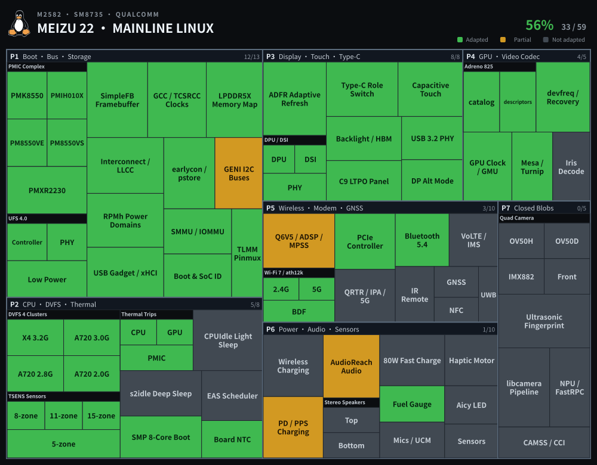

# MEIZU 22 · Mainline Linux

**MEIZU 22 (M2582) / Qualcomm SM8735 · Linux 7.2**

| State | Meaning |
|---|---|
| 🟩 **Adapted** | Verified on device, with a reproducible criterion |
| 🟨 **Partial** | Basically working, but a known problem remains |
| ⬛ **Not adapted** | Not started yet |

## Repositories

| Repository | Contents |
|---|---|
| [linux](https://github.com/MEIZU-22-SM8735-Development/linux) | Kernel tree, work branch `Linux-7.2-MEIZU_22-M2582`, baseline `Linux-7.2` |
| [firmware](https://github.com/MEIZU-22-SM8735-Development/firmware) | Vendor firmware blobs with sha256 manifest and redistribution notice |
| [tools](https://github.com/MEIZU-22-SM8735-Development/tools) | Build orchestration, boot image packing, serial console, USB networking |
| [initramfs](https://github.com/MEIZU-22-SM8735-Development/initramfs) | PID 1, rescue shell, static BusyBox/qbootctl/mke2fs builders |
| [rootfs](https://github.com/MEIZU-22-SM8735-Development/rootfs) | Arch Linux ARM root filesystem pipeline, installer, KDE payload |
| [mesa](https://github.com/MEIZU-22-SM8735-Development/mesa) | Mesa branch `meizu22-26.2.6` with Adreno 825 support |
| [.github](https://github.com/MEIZU-22-SM8735-Development/.github) | This profile and the progress chart |

## Start here

- [quickstart](quickstart.md) — build, flash and install from a fresh host.
- [validation](validation.md) — clean-room checklist and expected evidence.
- [repo map](repo-map.md) — how the repositories fit together.

